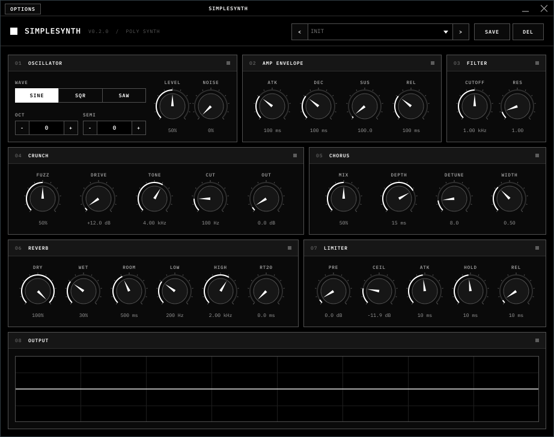

# SimpleSynth



A minimal polyphonic synthesizer: seven modules, one signal path, black and white.
Runs standalone or as a VST3 / Audio Unit plugin on Windows, macOS and Linux.

**[Website](https://ukhirani.github.io/simple-synth/)** · **[Download the latest release](https://github.com/ukhirani/simple-synth/releases/latest)**

## Modules

| # | Module | Controls |
|---|---|---|
| 01 | Oscillator | wave (sine / square / saw), octave, semitone, level, noise |
| 02 | Amp envelope | attack, decay, sustain, release |
| 03 | Filter | cutoff, resonance |
| 04 | Crunch | fuzz, drive, tone, cut, output |
| 05 | Chorus | mix, depth, detune, width |
| 06 | Reverb | dry, wet, room, low, high, RT20 |
| 07 | Limiter | pre-gain, ceiling, attack, hold, release |
| 08 | Output | oscilloscope, presets |

Double-click any knob to reset it. Presets are saved to `Documents/SYNTH8/SimpleSynth` as `.synth8` files.

## Download

Every push to `main` builds all platforms in GitHub Actions and publishes them as the
release `vX.Y.Z`, where the version comes from `project(... VERSION X.Y.Z)` in
`CMakeLists.txt`. Bump that number to cut a new release.

| Platform | File |
|---|---|
| Windows x64 | `SimpleSynth-Windows-x64.zip` (standalone `.exe`, VST3) |
| macOS Universal | `SimpleSynth-macOS-Universal.zip` (standalone `.app`, VST3, AU) |
| Linux x64 | `SimpleSynth-Linux-x64.tar.gz` (standalone, VST3) |

macOS builds are ad-hoc signed, not notarized: right-click the app and choose **Open** the first time.

## Build from source

Requirements: CMake 3.22+, a C++20 compiler, and on Linux the usual JUCE packages:

```bash
sudo apt install libasound2-dev libjack-jackd2-dev libfreetype-dev libfontconfig1-dev \
  libx11-dev libxcomposite-dev libxcursor-dev libxext-dev libxinerama-dev libxrandr-dev libgl1-mesa-dev
```

```bash
cmake -B build -DCMAKE_BUILD_TYPE=Release        # downloads JUCE 8.0.8 automatically
cmake --build build --config Release --parallel
```

Use `-DJUCE_SOURCE_DIR=/path/to/JUCE` to build against a local JUCE checkout instead.
Outputs land in `build/SimpleSynth_artefacts/Release/`.

## Project layout

```
Source/            plugin processor, voice and DSP glue, one file per editor module
Source/UI/         design tokens, LookAndFeel and shared controls (knob, stepper, scope)
Resources/Fonts/   IBM Plex Mono (SIL Open Font License)
website/           promo site: Vite + React + Astryx, custom "industrial" theme
.github/workflows/ build.yml (3-OS builds + release), pages.yml (website deploy)
```

## Design

Both the plugin editor and the website follow one design language: black and white only,
square corners, 1px rules, IBM Plex Mono. The website is built with
[Astryx](https://github.com/facebook/astryx), Meta's design system, using a custom theme in
`website/themes/industrial` (edit it with `npx astryx experimental theme editor`). The
plugin's JUCE `LookAndFeel` (`Source/UI/Theme.h`) uses the same color, spacing and type tokens.

## Dependencies

[JUCE](https://juce.com), [Maximilian](https://github.com/micknoise/Maximilian) and
[Signalsmith basics](https://github.com/Signalsmith-Audio/basics) for the DSP.
